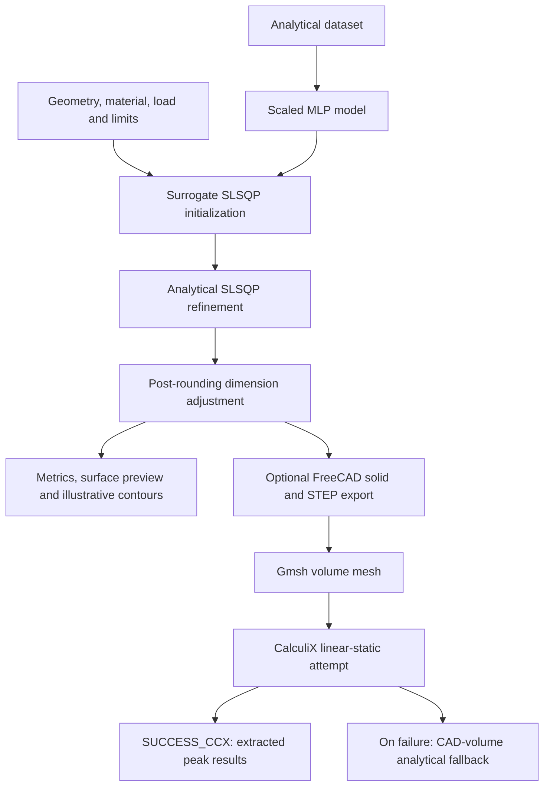

# Connecting Rod Design & Weight Optimization


**Explore connecting-rod geometry, predict structural response, and search for lighter designs.**

An interactive engineering project combining analytical mechanics, a neural-network surrogate, constrained optimization, and parametric 3D visualization. An optional FreeCAD–Gmsh–CalculiX workflow generates a CAD solid and attempts a linear-static finite-element analysis.

## Overview

Reducing connecting-rod mass requires balancing section dimensions against stress, stiffness, and packaging requirements. This application lets you explore that trade-off through a Streamlit interface: select dimensions, material, axial load, and design limits, then compare a candidate with an analytical baseline.

### Features

- **Parametric design:** adjust bore diameters, center distance, material, load, and safety limits.
- **Two-stage search:** initialize a design with an MLP surrogate, then refine it using analytical mechanics and SciPy SLSQP.
- **Interactive 3D view:** inspect geometry, illustrative stress/displacement contours, and magnified deformation.
- **Design comparison:** review mass, estimated stress, displacement, factor of safety, and dataset distributions.
- **CAD export:** download an STL preview and generate STEP through the FreeCAD workflow.
- **Optional FEA:** run FreeCAD, Gmsh, and CalculiX from the application or during dataset generation.

## Quick start

Clone the repository and install the Python dependencies in a fresh environment:

```bash
git clone https://github.com/Spectra6001/Automated-Connecting-Rod-Weight-Optimization.git
cd Automated-Connecting-Rod-Weight-Optimization
python -m venv .venv
```

Activate the environment:

```powershell
# Windows PowerShell
.\.venv\Scripts\Activate.ps1
```

```bash
# macOS / Linux
source .venv/bin/activate
```

Install and launch:

```bash
python -m pip install -r requirements.txt
python -m streamlit run app.py
```

Open the local URL printed by Streamlit. Use the sidebar to select packaging dimensions, material, load, and constraints. The app trains its cached surrogate on first use and recalculates the design as inputs change.

The repository includes a Windows `venv/` snapshot; a fresh environment is preferable. Python and package versions are not fully pinned. FreeCAD and its solver tools are separate installations and are unnecessary for the default analytical workflow.

## Understanding the results

The application contains several calculation paths. Their outputs have different meanings:

| Output | Source | Interpretation |
| --- | --- | --- |
| Default candidate and baseline metrics | `evaluate_rod_continuous` in `app.py` | Analytical mechanics estimates, including fields named `fea_verification`. |
| Displayed “AI Surrogate” candidate values | 25% MLP prediction + 75% analytical value | Blended estimates; not an independent model-versus-solver comparison. |
| 3D contours, deformation, and axial profiles | `compute_3d_fea_fields` | Constructed spatial fields scaled by analytical peaks; not imported solver fields. |
| FreeCAD result: `SUCCESS_CCX` | CalculiX results read through FreeCAD FEM | Worker-extracted peak stress and displacement; mass comes from CAD volume. |
| FreeCAD result: `SUCCESS_CAD_VERIFIED` | Analytical fallback using CAD volume | CAD-derived mass with analytical stress/displacement; this status does not establish solver success. |

The default dataset is analytically generated, not a collection of independent FEA simulations. The checked-in CSV contains 600 rows and has no solver-status/provenance column.

## Engineering method

The analytical model estimates volume and mass from end rings and an I-section shank. It estimates axial stress with stress-concentration factors and a buckling amplification, and displacement from shank and ring compliance. The app combines regional stress estimates using a smooth maximum for numerical optimization.

These are simplified engineering models. The source uses “FEA” in several function names and interface labels, but the default optimization does not invoke a finite-element solver.

### Optimization

The five design variables are ring thickness, shank width, beam thickness, pocket depth, and flange thickness. Packaging dimensions, material, and peak load remain fixed during each search.

The analytical refinement minimizes estimated mass:

$$
\min_{\mathbf{x}} m_{\mathrm{analytical}}(\mathbf{x})
$$

subject to stress, displacement, and section constraints:

$$
\sigma(\mathbf{x}) \leq \frac{\sigma_y}{1.01\,\mathrm{FoS}_{min}},
\qquad
\delta(\mathbf{x}) \leq 0.99\,\delta_{max}
$$

$$
h_b-2d_p \geq 3.5\;\mathrm{mm},
\qquad
w_s-2t_f \geq 4.0\;\mathrm{mm}.
$$

In `app.py`, a surrogate SLSQP run initializes the search, followed by four analytical refinement starts. A bounded, iterative adjustment thickens the design after rounding if the reported safety or displacement limits are missed.

The app's search bounds extend beyond the training ranges in `config.py`, and the adjustment can extend further. Predictions in those regions are extrapolations. The iteration cap, fallback candidate, and permissive candidate-selection tolerances mean the implementation does not provide a universal feasibility guarantee. Reported weight reduction compares analytical candidate and baseline masses.

The standalone `train_and_optimize.py` uses a separate implementation with eight surrogate starts, four analytical starts, and the narrower configuration bounds. Its results need not match the app.

## Machine learning

Both training implementations use:

- **Inputs:** eight geometry parameters, peak load, Young's modulus, density, and yield strength.
- **Targets:** mass, maximum equivalent stress, and maximum displacement.
- **Network:** scikit-learn `MLPRegressor`, hidden layers `(128, 128, 64)`, ReLU activation, and Adam.
- **Training:** standardized inputs and targets, learning rate `0.002`, up to 1,000 iterations, seed 42.
- **Evaluation:** a random 80/20 split, reporting per-target R² and mean absolute error.

The app trains and caches its model in memory. The standalone script saves a model bundle to `models/nn_surrogate_model.pkl`. Evaluation measures agreement with the dataset; it is not independent structural validation. Geometry-grouped cross-validation is not implemented.

## Parametric geometry and optional FEA

The application builds a triangulated surface for visualization and STL export. FreeCAD independently constructs a solid using cylinders, a shank, bore cuts, and lightweighting pockets. These geometry representations should not be assumed identical.

To enable the live solver workflow:

1. Install FreeCAD with its FEM workbench and make Gmsh and CalculiX available.
2. Set `FREECAD_CMD_PATH` in [config.py](config.py) to your FreeCAD command executable. The current default points to FreeCAD 1.1 on Windows.
3. Launch the app and select **Run FreeCAD + CalculiX FEA**.

The worker exports STEP, fixes the big-end bore, applies force at the small-end bore, and requests a linear-static analysis with Gmsh characteristic lengths of 1.5–4.0 mm. The app launches this synchronously; it can take time and has no explicit subprocess timeout.

Inspect the returned status. Exceptions inside the worker's FEM block, or absence of positive extracted stress, lead to analytical fallback. Even a `SUCCESS_CCX` result includes analytically calculated `zone_stresses`; those regional values are not extracted solver fields. The main contour view remains constructed from analytical values after the live run.

## Architecture



## Repository guide

| File or directory | Purpose |
| --- | --- |
| [app.py](app.py) | Streamlit UI, cached training, analytical optimization, surface visualization, live worker launch |
| [config.py](config.py) | Material properties, training bounds, file paths, FreeCAD executable |
| [generate_dataset.py](generate_dataset.py) | Latin-hypercube sampling, analytical evaluator, optional worker execution |
| [train_and_optimize.py](train_and_optimize.py) | Standalone model training, serialization, and optimization |
| [freecad_worker.py](freecad_worker.py) | CAD construction, STEP/STL export, FEM attempt, analytical fallback |
| [requirements.txt](requirements.txt) | Python dependencies |
| [data/](data/) | Training CSV |
| [models/](models/) | Serialized standalone model |
| [exports/](exports/) | CAD exports and live worker input/output |

**Stack:** Python · Streamlit · NumPy · pandas · SciPy · scikit-learn · Plotly · trimesh · joblib · optional FreeCAD/Gmsh/CalculiX.

## Dataset generation and standalone training

```bash
# Generate 600 analytical Latin-hypercube samples.
python generate_dataset.py --samples 600

# Attempt FreeCAD/CalculiX evaluation for a small batch.
python generate_dataset.py --samples 10 --use-freecad

# Retrain the standalone model and run its default optimization.
python train_and_optimize.py
```

Dataset generation replaces the configured CSV. The app regenerates 600 analytical rows if the CSV is missing, unreadable, or has fewer than 500 rows; standalone training regenerates when missing or below 300 rows. A small solver batch can therefore be replaced when either training path starts. Preserve experimental datasets separately.

The app and standalone generator use different analytical stress aggregation. Record the generator and revision when comparing datasets or metrics.

## Scope and limitations

This project supports design exploration and educational research. Mechanical qualification requires further evidence:

- The scalar axial load does not model a crank-angle engine cycle, fatigue, or nonlinear pin contact.
- Material values are model assumptions; no certified material or experimental component validation is supplied.
- Analytical metrics and constructed contours cannot establish real component stress distributions.
- Local SLSQP searches and dimension adjustments do not establish global optimality.
- Solver completion checks are limited; mesh convergence and independent solver verification are not established by a successful worker status.
- No automated test suite or CI workflow is provided in this source snapshot.

### Development directions

- Persist dataset provenance and distinguish predictions, analytical estimates, and solver outputs in the UI.
- Import actual solver fields for visualization and verify CAD/mesh consistency.
- Add convergence studies, grouped model evaluation, and explicit feasibility checks.
- Extend loading, contact, fatigue, and experimental validation.

## Contributors

The application credits **Bhagavat Pratim Das (24JE0493)** and **Hiten Arora (24JE0503)**.

Built with open-source scientific computing, visualization, CAD, and finite-element tools. Thanks to their maintainers and communities.
